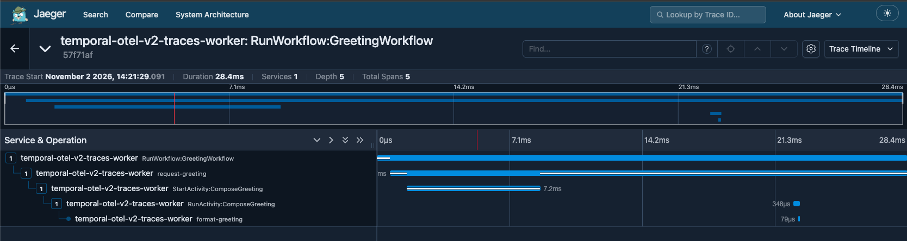

## Traces

This sample instruments a Workflow and an Activity to emit traces.

By default, it also turns on Temporal SDK operation spans with
`setAddTemporalSpans(true)` in
[`TracesWorker.java`](TracesWorker.java). Comment out that line to turn them
off and keep only the custom spans.

### Run the sample

1. Run a [Temporal Service](../../../../../../../../../README.md#running-samples).

2. Start Jaeger from the repository root:

```bash
docker compose -f opentelemetry-v2/docker-compose.yaml up -d
```

3. Start the Worker:

```bash
./gradlew -q :opentelemetry-v2:execute -PmainClass=io.temporal.samples.opentelemetryv2.traces.TracesWorker
```

4. In another terminal, start the Workflow:

```bash
temporal workflow execute \
  --task-queue traces \
  --type GreetingWorkflow \
  --input '"Temporal"'
```

5. Inspect the `temporal-otel-v2-traces-worker` service in the
   [Jaeger UI](http://127.0.0.1:16686). The trace shows the custom
   `request-greeting` and `format-greeting` spans. With Temporal spans on, it
   also shows `RunWorkflow:GreetingWorkflow`, `StartActivity:ComposeGreeting`,
   and `RunActivity:ComposeGreeting`.

   
